# BT10X User Manual

**BattleTech primer for game developers, with walkthroughs of BT10X Terminal and Instant Action**

| | |
|---|---|
| Written | 2026-11-05 |
| Terminal | v261102-6fa51431 |
| Instant Action | v261104-48d89942 |
| Engine | 261102-64c4d26b |

## Contents

0. [About this manual](#0-about-this-manual)
1. [The BattleTech universe](#1-the-battletech-universe)
2. [Tabletop rules in brief](#2-tabletop-rules-in-brief)
3. [The two tools at a glance](#3-the-two-tools-at-a-glance)
4. [Terminal walkthrough](#4-terminal-walkthrough)
5. [Instant Action walkthrough](#5-instant-action-walkthrough)
6. [Glossary](#6-glossary)
7. [FAQ](#7-faq)

---

## 0. About this manual

BT10X is a web-based combat simulator that implements a subset of *Total Warfare*, the core BattleTech rulebook. It has two clients that share the same engine: the **Terminal**, driven by text commands, and **Instant Action**, driven by mouse and keyboard.

This manual is for people who know game development and design but have never played tabletop board games, and BattleTech in particular. Chapters 1–2 explain the setting and core rules in game-systems terms. Chapters 4–5 walk through actual play, screen by screen.

All screenshots were captured during real play with the English locale. Dice results depend on the random seed; use the seeds given in the text to reproduce the same results.

> **Note** BT10X is an unofficial fan project, not affiliated with or endorsed by Catalyst Game Labs, The Topps Company, or Microsoft. Page references such as "TW p.256" are the *Total Warfare* rulebook pages that the game itself cites.

---

## 1. The BattleTech universe

It is the 31st century. Humanity's interstellar civilization has collapsed, and noble houses have been at war for centuries. The main weapon of those wars is the **BattleMech**: a humanoid combat machine more than 10 m tall.

BattleTech began as a tabletop wargame published by FASA in 1984 and has been an active IP for over 40 years. Today the tabletop game is published by Catalyst Game Labs. On the video game side, the *MechWarrior* series and Harebrained Schemes' turn-based tactics game *BattleTech* (2018) are the best known. It is giant-robot fiction, but closer to tank or naval warfare than to super-robot anime: hard military SF.

| Concept | Description |
|---|---|
| **Inner Sphere** | The region of human space within roughly 500 light-years of Terra. After the Star League fell, five Great Houses (Steiner, Davion, Kurita, Liao, Marik) divided it and have fought the Succession Wars ever since. |
| **Clans** | Descendants of the Star League Defense Force who evolved into a separate warrior society beyond the Inner Sphere. They invade in 3050 with superior technology. A 'Mech listed with tech base "Clan" uses their equipment. |
| **MechWarrior** | A 'Mech pilot. In game terms, a pilot is two numbers: **Gunnery** and **Piloting**. Lower is better. The default is 4/5 (Regular). |
| **Eras and technology** | Lost technology is rediscovered over time. The "Era" year in the 'Mech list is when that design appeared; BT10X can filter by era (for example ≤3150). |

### 'Mech weight classes

'Mechs are classified by tonnage. Heavier 'Mechs carry more armor and firepower but move slower. BT10X includes 399 'Mechs across 138 chassis.

| Class | Tonnage | In BT10X | Role and examples |
|---|---|---|---|
| Light | 20–35 t | 86 | Fast scouting and harassment. e.g. Commando, Jenner |
| Medium | 40–55 t | 102 | Balance of speed and firepower. e.g. Centurion, Hatchetman |
| Heavy | 60–75 t | 110 | The backbone of the battle line |
| Assault | 80–100 t | 101 | Slow but overwhelming. e.g. Atlas, Awesome |

---

## 2. Tabletop rules in brief

BattleTech is a turn-based tactics game played on a hexagonal map, resolved with two six-sided dice (2D6). Think of turn-based tactics games such as XCOM, but with much higher data resolution: each 'Mech tracks armor per body location, and every weapon generates heat.

| Concept | What it is | Game-dev analogy |
|---|---|---|
| **Hex map** | Each hex is 30 m. Coordinates are 4 digits, column then row (0815 = column 8, row 15). Terrain such as woods and elevation changes movement cost and to-hit. | Tile grid with per-tile cost and cover modifiers |
| **Record sheet** | One 'Mech's full sheet: armor and internal structure per location, weapons list, heat track, critical slots. | The unit's entire runtime state |
| **BV (Battle Value)** | A combat-strength score per 'Mech. Sides with equal BV make a fair match. | Matchmaking rating |
| **Seeded dice** | BT10X lets you set the random seed; the same seed and the same inputs replay the same battle. | Deterministic replay |

### Turn structure

Each turn goes through these phases in order. The current turn and phase are always shown in the prompt (Terminal) or the top bar (Instant Action).

```
Initiative  →  Movement  →  Attack (weapons, physical)  →  Heat  →  End
```

- **Initiative**: each side rolls 2D6; the higher roll wins. The winner moves *last*, which is an advantage because it can react to the opponent's moves.
- **Movement**: units move one at a time, alternating, starting with the side that lost initiative. Choose stand still, walk, run or jump, then pick a destination and facing within your movement points (MP).
- **Attack**: every unit *declares* its attacks, then all are *resolved* at once. A 'Mech destroyed this turn still gets to fire.
- **Heat**: heat built up by movement and firing is reduced by the heat sinks (HS). Leftover heat causes penalties.

### To-hit

Every shot has a target number (TN). Roll 2D6; if the result is equal to or higher than the TN, it hits. Modifiers are additive, so each +1 to the TN changes the odds a lot.

```
TN = Gunnery + attacker movement + target movement (TMM) + terrain + range (+ others)
```

Example from the walkthrough: the Centurion's Gauss Rifle needs `gunnery 4 + move 1 + target 1 + terrain 1 + range 2 = 9`. A 2D6 roll of 9 or more happens 10 times in 36, about 28%. The game shows this probability next to each weapon.

| TN | 2 | 4 | 6 | 7 | 8 | 9 | 10 | 11 | 12 |
|---|---|---|---|---|---|---|---|---|---|
| Hit chance | 100% | 92% | 72% | 58% | 42% | 28% | 17% | 8% | 3% |

### Damage and heat

On a hit, 2D6 determines the **hit location**: head (HD), center torso (CT), left/right torso (LT/RT), left/right arm (LA/RA), left/right leg (LL/RL). Damage removes armor first. Once armor is gone it removes internal structure and triggers **critical hit** checks (destroyed equipment, ammo explosions and so on). When the center torso's internal structure reaches 0, the 'Mech is destroyed.

**Heat** is BattleTech's central resource. Every weapon generates heat when fired. Exceeding heat sink capacity costs movement and accuracy, and at worst causes shutdown or ammo explosions. The trade-off between firing everything (an "alpha strike") and managing heat is the core decision every turn.

---

## 3. The two tools at a glance

If you want to understand the rules precisely, start with the Terminal. If you want to play right away, start with Instant Action.

| | Terminal | Instant Action |
|---|---|---|
| URL | <https://bt10x.stoneworks.dev/terminal> | <https://bt10x.stoneworks.dev/instant> |
| Input | Typed text commands | Mouse clicks and keyboard shortcuts |
| Map | ASCII hex grid | Isometric map with rotate and zoom |
| Combat log | Every modifier and dice roll, step by step | Summary in the LOGS panel |
| AI opponents | Assign personas with `pp` | Pick in each unit's Control column |
| Scale | Any number of units | Up to 4 vs 4 |
| Best for | Learning rules, verifying rolls, reproducible tests | Quick games, demos, newcomers |

---

## 4. Terminal walkthrough

This walkthrough sets up a 1-vs-1 battle between a Centurion (team 1) and a Hatchetman (team 2) and plays through the first turn's movement and attacks. The prompt always shows the current phase and the acting unit. If you get stuck, type `help`.

### Step 1. Open the terminal

The top bar shows the terminal and engine versions, plus **MOTD** (message of the day) and **← bt10x** (home). The input line is at the bottom. The starting prompt is `setup >`. Output is in English by default; `lang ko` switches to Korean and `lang en` switches back.

`help` lists *only the commands available in the current phase*. The list changes as the phase changes. Use `help add` and so on for a command's arguments.

[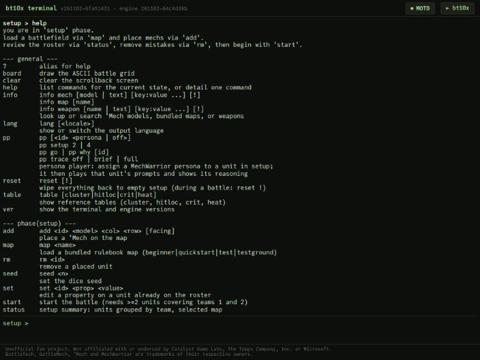](t01_help.png)

*Figure 1. `help` in the setup phase, split into general and phase(setup) commands. — [t01_help.png](t01_help.png)*

### Step 2. Find maps and 'Mechs

Use `info map` for the bundled maps and `info mech` to search 'Mechs. Searches combine name text and filters.

```
setup > info map
beginner: 15x16   quickstart: 15x16   test: 7x7   testground: 16x26
setup > info mech class:m tech:is pack:base     # medium, Inner Sphere, base pack
CDA-3MA Cicada · HER-5SA Hermes II · HCT-5S Hatchetman · CN9-YLW2 Centurion · BSW-X1 Bushwacker
```

Filters: `class:l|m|h|a` (weight class), `ton:50` or `ton:40-55` (tonnage), `tech:is|clan`, `pack:base|sw`. Add `!` to see the full list.

### Step 3. Set up the battlefield and place units

Load a map, fix the seed, and place two 'Mechs. The format is `add <id> <model> <col> <row> [facing]`, where facing is one of `n ne se s sw nw`. Teams alternate 1, 2 in the order you add units; change one with `set <id> team 2`.

```
setup > map quickstart
setup > seed 42
setup > add cn CN9-YLW2 8 15 n
setup > add hc HCT-5S 8 2 s
setup > status
```

[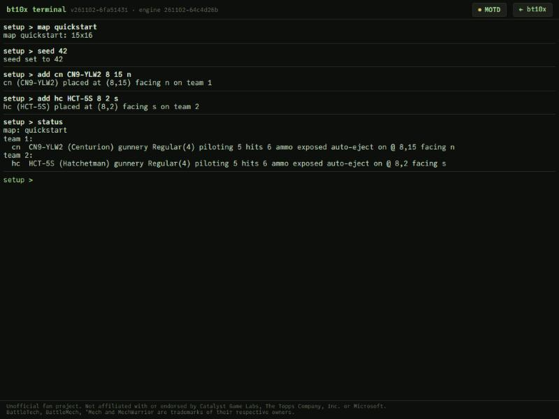](t02_setup.png)

*Figure 2. The roster shown by `status`: gunnery Regular(4), piloting 5, ammo policy and auto-eject per unit. — [t02_setup.png](t02_setup.png)*

Use `set` to change `gunnery`, `piloting`, `ammoPolicy` and other properties. Remove a misplaced unit with `rm <id>`.

### Step 4. Look at the battlefield: board

`board` draws the whole map as ASCII hexes. The 4 digits at the top of each hex are its coordinates; the symbols below are terrain (`W` heavy woods, `w` light woods) and elevation. Units appear by id with a facing arrow (▲▼).

[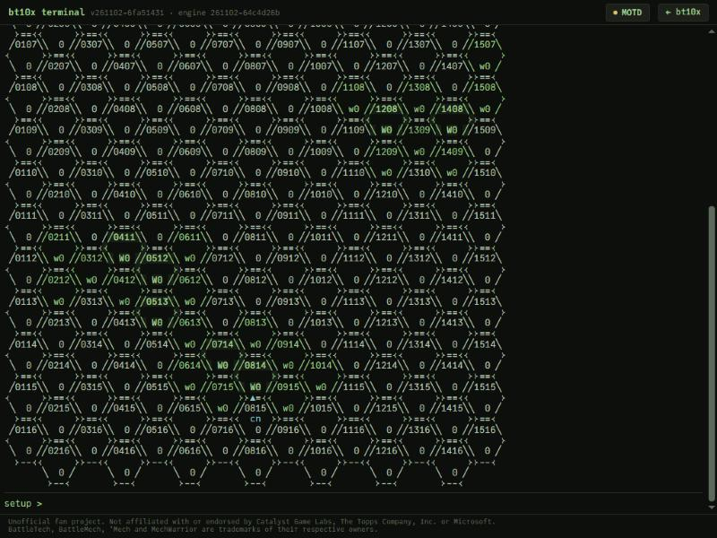](t03_board.png)

*Figure 3. Lower half of the quickstart map. `cn` stands in hex 0815 facing north (▲), surrounded by woods. — [t03_board.png](t03_board.png)*

### Step 5. Start the battle and declare a movement mode

`start` rolls initiative and begins the movement phase. In this example team 2 wins initiative, so team 1's `cn` moves first. The prompt changes to `turn(1):move(cn, team 1) >`.

Declare walking with `mode walk`. A map appears with every reachable hex marked `<>`. `candidate` shows the same map again.

[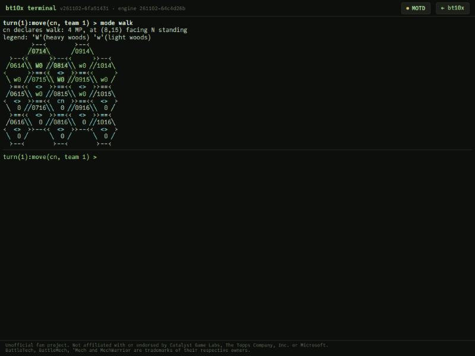](t04_candidate.png)

*Figure 4. Hexes reachable with 4 walking MP (`<>`). Woods are expensive, so the 'Mech cannot go far. — [t04_candidate.png](t04_candidate.png)*

### Step 6. Queue a destination and confirm

`place <col> <row> <facing>` queues a destination and shows the path and MP cost. `status` shows the turn order and what is queued. `done` confirms. Before confirming, `cancel` clears the queue; after confirming, `rollback` undoes the last `done`.

```
turn(1):move(cn, team 1) > place 8 14 n
cn walk: (8,15) N to (8,14) N standing, 3/4 MP
  forward (8,14) heavy woods: 3 MP (+2 terrain)
turn(1):move(cn, team 1) > done
```

[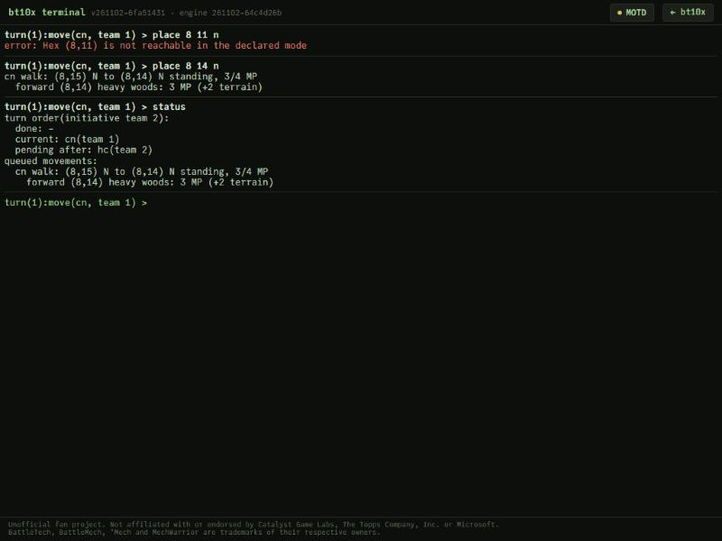](t05_place.png)

*Figure 5. `place 8 11 n` fails (not enough MP), `place 8 14 n` succeeds, and `status` shows `current: cn`, `pending after: hc`. — [t05_place.png](t05_place.png)*

> **Common error** `error: Hex (8,11) is not reachable in the declared mode` means you do not have enough MP. Heavy woods cost +2 MP per hex. Pick one of the candidate hexes or switch to `mode run`.

When it is `hc`'s turn, do the same: `mode walk`, `place 8 6 s`, `done`.

### Step 7. Check attack candidates and declare fire

Once all movement is done, the attack phase begins. The acting unit's usable weapons and target numbers are listed automatically. Each line ends with a ready-to-type command.

[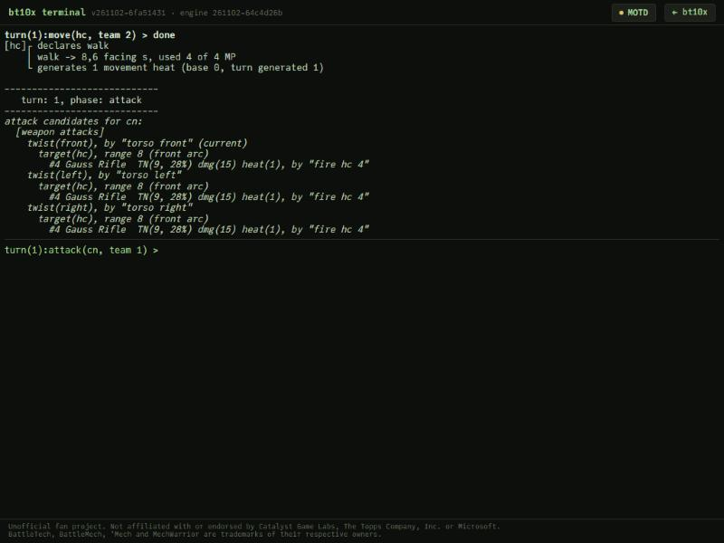](t06_attack.png)

*Figure 6. Attack candidates for `cn`: Gauss Rifle (#4) at TN 9 (28%), 15 damage, 1 heat. Options are listed per torso twist. — [t06_attack.png](t06_attack.png)*

```
turn(1):attack(cn, team 1) > fire hc 4      # queue weapon 4 at hc
turn(1):attack(cn, team 1) > done
turn(1):attack(hc, team 2) > fire cn 1
turn(1):attack(hc, team 2) > done
```

Fire several weapons at once with `fire hc 1 2 4`. Against an adjacent enemy you can also `punch`, `kick`, or `strike` with a hatchet or sword.

### Step 8. Read the results

When the last unit types `done`, all fire resolves at once. The log shows the TN breakdown, the dice, the hit location and the armor change.

[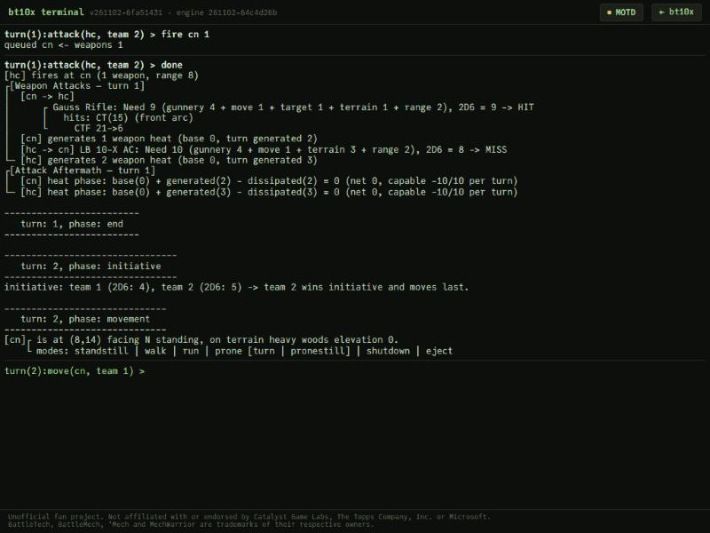](t07_resolve.png)

*Figure 7. Turn 1: `cn`'s Gauss rolls 9 and hits `hc`'s center torso front for 15 (CTF 21->6). `hc`'s LB 10-X AC rolls 8 and misses. Heat and turn 2 initiative follow. — [t07_resolve.png](t07_resolve.png)*

`CTF 21->6` means "center torso front armor went from 21 to 6". In the heat line, `capable -10/10 per turn` is the heat sink capacity.

### Step 9. Read the record sheet

`sheet <id>` shows a unit's current state. The armor diagram on the right shows `current/max` per location. Suffixes: `F` front armor, `R` rear armor, `A` armor, `I` internal structure. Expand **critical slots** to see equipment per location.

[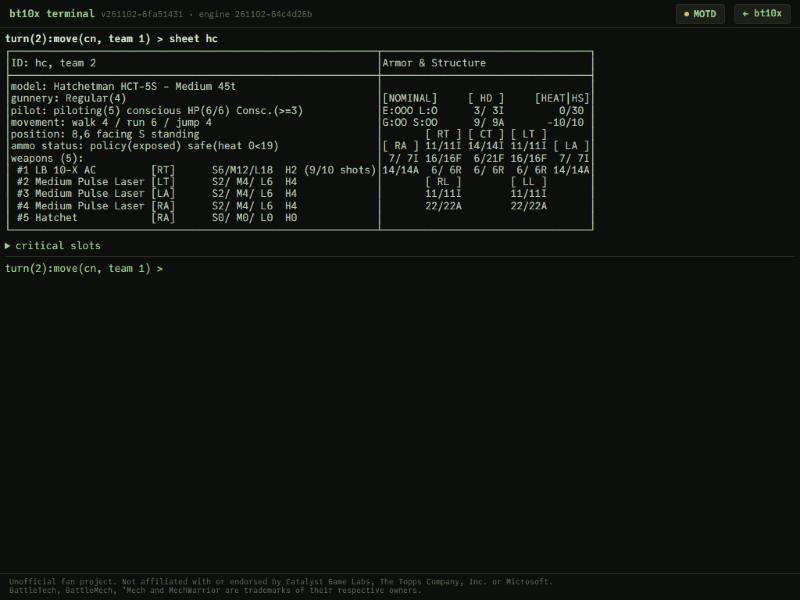](t08_sheet.png)

*Figure 8. The Hatchetman after the hit: CT front armor is 6/21F. In the weapon list, S/M/L are short/medium/long range brackets and H is heat. — [t08_sheet.png](t08_sheet.png)*

Other references: `heat` for the heat track, and `table hitloc` (hit locations), `table cluster` (missile hits), `table crit`, `table heat`.

### Step 10. Watch AI personas fight

A fast way to learn the flow of the rules is to let AI personas fight each other and read the log. From an empty setup (during a battle, `reset !` first):

```
setup > seed 7
setup > pp setup 2       # random 1v1: map, 'Mechs, positions and personas
setup > start
```

For every decision, the persona prints how many options it scored, the top choices with their scores, and why it picked one. Control the detail with `pp trace off|brief|full`. To hand only one unit to the AI, use `pp <id> <persona>` during setup.

[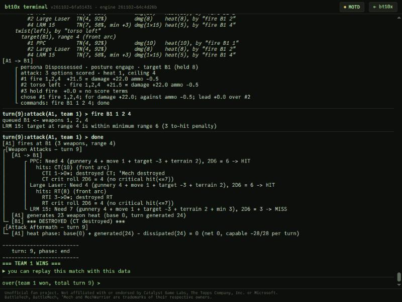](t09_pp_end.png)

*Figure 9. Seed 7: the Awesome (Dispossessed) fires PPC, Large Laser and LRM 15 together, destroys the Commando's CT, and team 1 wins on turn 9. — [t09_pp_end.png](t09_pp_end.png)*

Personas: `alpha`, `longtom`, `jumpjockey`, `hulldown`, `pitfighter`, `gladiator`, `dispossessed`. See the [persona table](#persona-types) in chapter 5.

### Terminal command summary

| Phase | Commands | Purpose |
|---|---|---|
| Any | `help [cmd]` `clear` `board` `info` `lang` `table` `reset` `ver` | Help, clear screen, map, data lookup, language, reference tables, reset, version |
| Setup | `map` `add` `rm` `set` `seed` `status` `start` `pp` | Choose map; add, remove, edit units; seed; roster; start; assign AI |
| Movement | `mode` `candidate` `place` `status` `done` `cancel` `rollback` | Declare mode, reachable hexes, queue destination, confirm, cancel, undo |
| Attack | `candidate` `fire` `torso` `punch` `kick` `club` `strike` `done` | Attack options, fire, torso twist, physical attacks, confirm |
| Info | `sheet [id]` `heat [id]` `policy` | Record sheet, heat, ammo and eject policy |

---

## 5. Instant Action walkthrough

Instant Action wraps the same engine in a graphical UI. This walkthrough builds a Centurion (player, side 1) vs Jenner (AI persona, side 2) match in Attrition mode.

### Step 1. Title screen

The menu has **New battle** (build your own), **Random battle** (auto-generated) and **Options**. Use <kbd>↑</kbd> <kbd>↓</kbd> to select and <kbd>Enter</kbd> to confirm, or click.

The top bar adjusts font size (**A** smaller / larger; **Fit** picks the largest size that fits the window) and language (**EN** / **한국어**).

[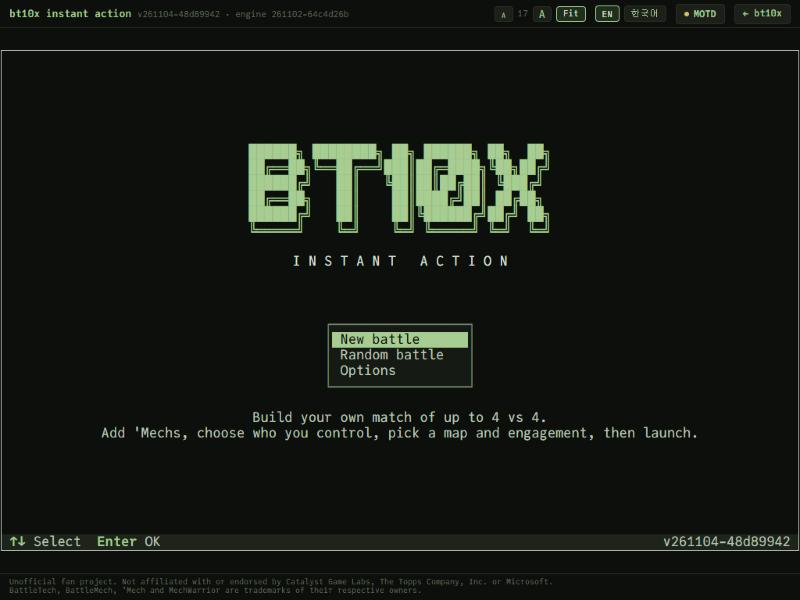](i01_title.png)

*Figure 10. Instant Action title screen. — [i01_title.png](i01_title.png)*

### Step 2. New Battle: the setup screen

The top half holds the SIDE 1 (blue) and SIDE 2 (red) rosters. Bottom left is the map preview; bottom right holds battle settings. If something is missing, a red message tells you what (for example "Side 1 needs at least one 'Mech.").

[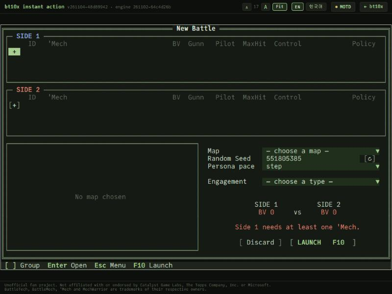](i02_newbattle.png)

*Figure 11. Empty setup. Each side's [+] adds a 'Mech. — [i02_newbattle.png](i02_newbattle.png)*

[+] adds a random 'Mech. Roster columns: ID, 'Mech, BV, Gunn (gunnery), Pilot (piloting), MaxHit (pilot hit points), Control, Policy.

### Step 3. Choose a 'Mech

Click the 'Mech name to open **Choose 'Mech**. The left side holds search options and the list; the right side shows the selected design's weapons and armor diagram.

[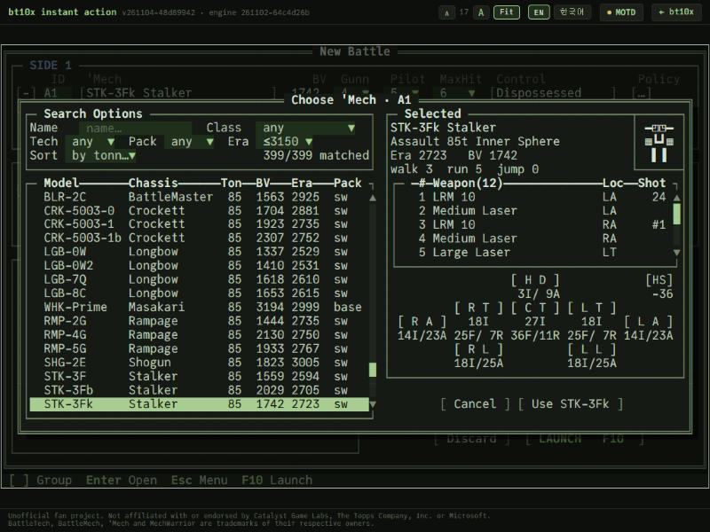](i03_mechpicker.png)

*Figure 12. Choose 'Mech. Filter by Class, Tech, Pack and Era, and choose a sort order. — [i03_mechpicker.png](i03_mechpicker.png)*

Type `Centurion` into Name to narrow the list to 4 models. Select one and click **[Use CN9-A]**.

[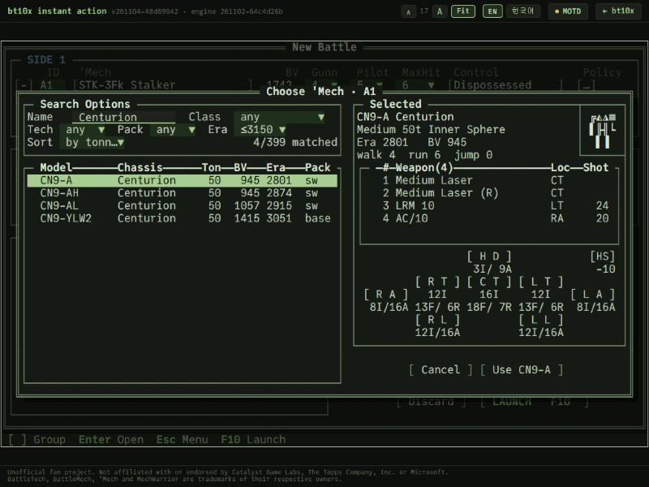](i04_search.png)

*Figure 13. CN9-A: a 50-ton medium with 2 Medium Lasers (one rear-mounted, marked R), LRM 10 and AC/10. BV 945. — [i04_search.png](i04_search.png)*

### Step 4. Control: player or persona

Click the Control cell to choose who drives the unit. **Player** means you give every order; the rest are AI personas. The right pane describes the persona, and below it are its **Move weights** (Cover, Flank, Melee, Exposure, Own TMM, Crowd, Ammo) and **Settings** (range, heat limit, ammo, melee, jump jets, when it yields). This exposes the AI's decision model directly.

[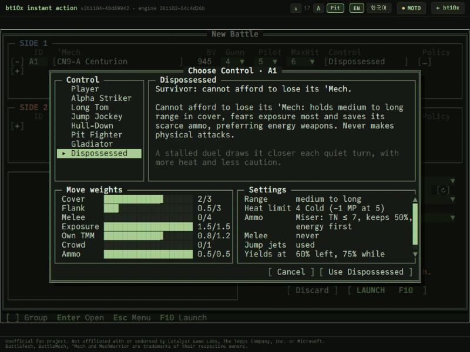](i05_persona.png)

*Figure 14. Dispossessed: holds medium to long range in cover and fears exposure most. — [i05_persona.png](i05_persona.png)*

#### Persona types

The descriptions below are quoted verbatim from the game's source code (`persona.tag.*` and `persona.body.*` strings). The key in parentheses is what the Terminal's `pp` command uses.

| Control | Type | Behavior |
|---|---|---|
| Player | You give this 'Mech every order. | Movement, weapon fire and physical attacks are yours to order. The unit's Policy (ammo, auto-eject, flamer heat, AMS) still applies. |
| Alpha Striker (`alpha`) | Brawler: walks in and fires everything. | Walks straight in to short range, barely minding cover, and fires everything it has. Never jumps. Adjacent, it punches, kicks (only at to-hit 8 or better) or strikes; it never charges. |
| Long Tom (`longtom`) | Sniper: keeps to its longest range. | Stands at the near edge of its long range, values cover and avoids exposure. Its low heat limit means it rarely runs or jumps while firing heavy weapons. Never makes physical attacks. |
| Jump Jockey (`jumpjockey`) | Flanker: jumps into the target's side or rear. | Holds medium range and values flanking above all: long jumps that land in the target's side or rear arc score well despite the to-hit penalty for jumping. Makes physical attacks when adjacent anyway. |
| Hull-Down (`hulldown`) | Defender: takes cover and waits. | Picks woods and partial cover and moves little. Keeps cold while the target is beyond its medium range (posture "hold"), and accepts more heat once the target is closer. |
| Pit Fighter (`pitfighter`) | Melee specialist: closes for contact. | Goes for contact: charges or makes a death from above whenever it can reach its target. Adjacent, it kicks at any to-hit, punches with both arms, swings a hatchet or club, and picks up a club when that beats its bare hands. |
| Gladiator (`gladiator`) | Showman: fights face to face, never yields. | Plays to the crowd: fights face to face within 3 hexes, barely minds exposure and runs heat up to automatic shutdown. Charges and makes a death from above when they beat its guns, otherwise fights hand to hand like the Pit Fighter. |
| Dispossessed (`dispossessed`) | Survivor: cannot afford to lose its 'Mech. | Cannot afford to lose its 'Mech: holds medium to long range in cover, fears exposure most and saves its scarce ammo, preferring energy weapons. Never makes physical attacks. |

"Death from above" (DFA) is a physical attack where a 'Mech jumps and lands on its target. In BattleTech lore, the "Dispossessed" are MechWarriors who have lost their 'Mech, and with it their livelihood and status, which is why this persona fights so cautiously.

In this walkthrough A1 is set to **Player**. B1, added with side 2's [+], came up as a JR7-F Jenner controlled by **Alpha Striker**, and is left that way.

### Step 5. Map, engagement and persona pace

Bottom right: choose a **Map** (beginner, quickstart, test, testground) and a preview appears on the left. **Random Seed** can be re-rolled with [↻] or typed in to reproduce a battle.

[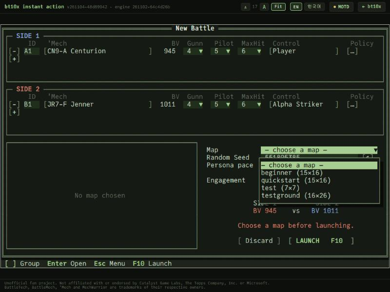](i06_map.png)

*Figure 15. Map dropdown; the size in hexes is in parentheses. — [i06_map.png](i06_map.png)*

**Engagement** is Annihilation or Attrition. You cannot launch without choosing one.

[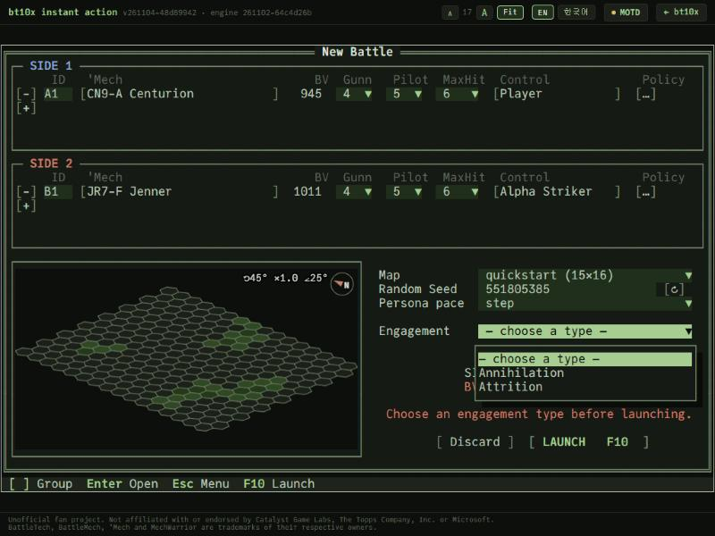](i07_engagement.png)

*Figure 16. Engagement dropdown. — [i07_engagement.png](i07_engagement.png)*

| Engagement | Victory condition | Battle header |
|---|---|---|
| Annihilation | Destroy every 'Mech on the other side. No turn limit. | Units remaining per side |
| Attrition | A scoring race over a configured number of turns. The source code calls this mode `damageRace`: the score is damage dealt to the enemy. The side with the higher score when the turn limit runs out wins. Set the length in the **Turn Limit** field that appears when Attrition is chosen (default 10). | `Attrition · A : B` (each side's score) |

Attrition finishes quickly, which suits demos and firepower comparisons. Annihilation plays out a full fight, including heat management and survival.

**Persona pace** controls AI turns: *instant* runs them immediately, *step* waits for you to confirm each one, and *timed* advances at an interval. *step* makes it easiest to follow the AI's decisions at first.

[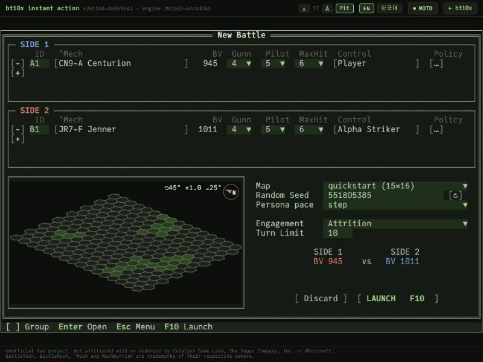](i08_ready_attrition.png)

*Figure 17. Ready to launch: Attrition with Turn Limit 10. BV 945 vs 1011 is close enough for a fair fight. Click [LAUNCH] or press F10. — [i08_ready_attrition.png](i08_ready_attrition.png)*

### Step 6. Deployment: choose a home edge

On launch, each side rolls 2D6 and the winner picks its home edge (North, South, West, East; TW p.256). Side 1 won here, so pick South.

[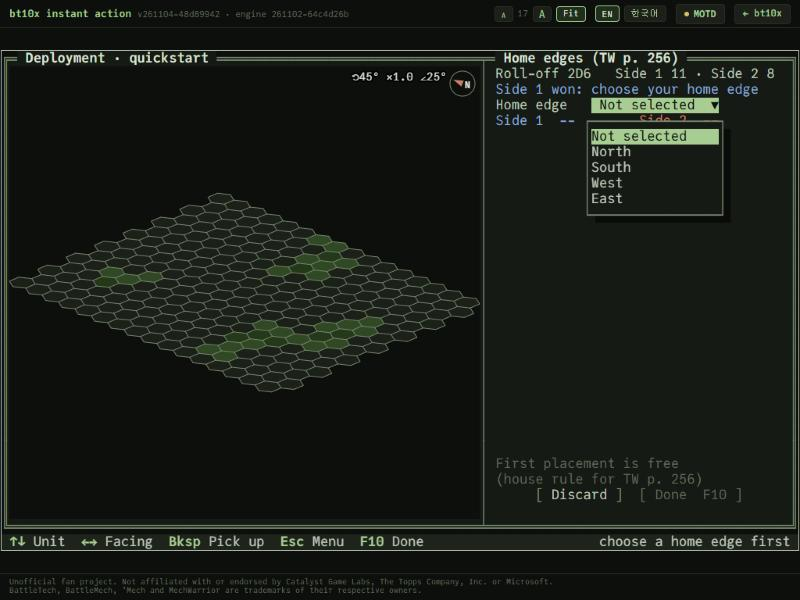](i09_edge.png)

*Figure 18. Home edge dropdown after the roll-off (Side 1 11, Side 2 8). — [i09_edge.png](i09_edge.png)*

After you choose, units are placed automatically and valid deployment hexes are highlighted. Click another highlighted hex to move a unit, or use <kbd>←</kbd> <kbd>→</kbd> to change facing. First placement costs no MP. Click **[Done F10]** when ready.

[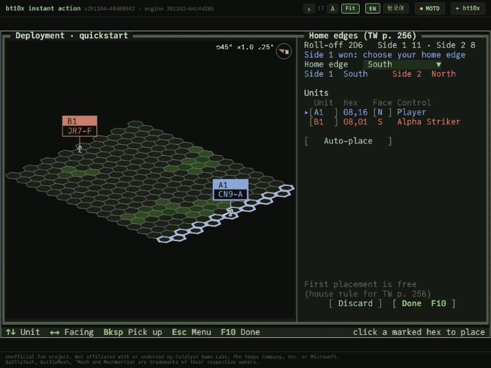](i10_deploy.png)

*Figure 19. Deployment: A1 starts at 08,16 (south), B1 at 08,01 (north). — [i10_deploy.png](i10_deploy.png)*

### Step 7. Read the battle screen

The top strip shows the engagement and score (`Attrition · 0 : 0`), **Turn** (`1/10` in Attrition), **Phase**, and **Action Order** (▶ marks the acting unit). Below it is the **Movement Command** panel (or Attack Command). The left panel summarizes the acting unit's record sheet, using the same notation as the Terminal. The numbers at the top right of the map are rotation, zoom and tilt; the bottom bar lists shortcuts.

[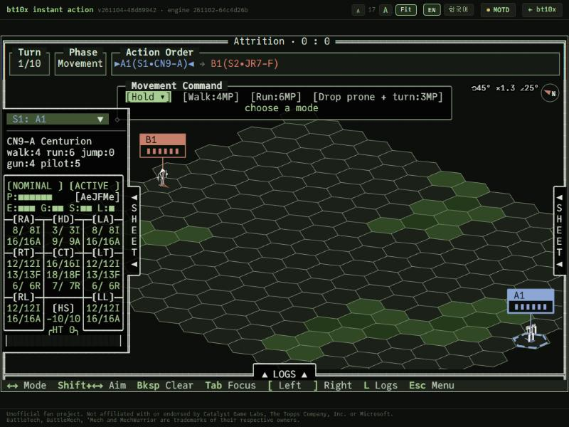](i11_battle.png)

*Figure 20. Turn 1 movement, waiting for the player to choose a mode for A1. — [i11_battle.png](i11_battle.png)*

### Step 8. Move

Click **[Walk:4MP]** in the Movement Command panel. Reachable hexes turn blue, each labeled with its MP cost. Click a destination: a translucent ghost of the 'Mech shows where it will end up, and the panel summarizes it, for example `to (8,14) N · 4 MP`. Change facing with <kbd>←</kbd> <kbd>→</kbd>; clear with <kbd>Bksp</kbd>.

[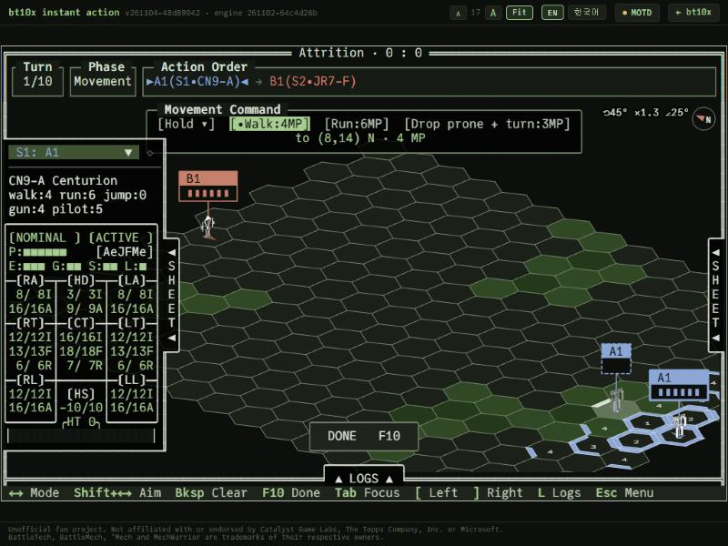](i12_move.png)

*Figure 21. Destination chosen: the path is drawn in white and A1's ghost marks the end hex. Confirm with [DONE F10]. — [i12_move.png](i12_move.png)*

When an AI unit acts, the screen says "B1 is played by a persona" and shows **[NEXT PERSONA]**. Click it or press <kbd>Enter</kbd>.

[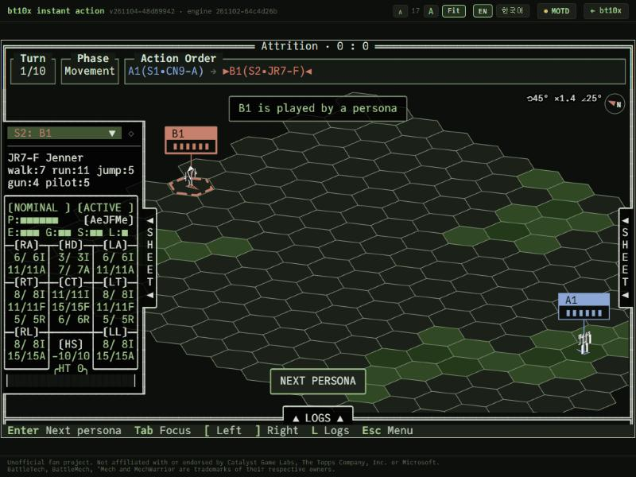](i13_persona_turn.png)

*Figure 22. A persona's turn. With pace set to step, it waits for your confirmation. — [i13_persona_turn.png](i13_persona_turn.png)*

### Step 9. Attack

In the attack phase the **Attack Command** panel appears and a line of fire (yellow dashes) is drawn on the map. Choose the Twist (Left, Front, Right) and Weapon Target, then click **[0 selected out of 2 available weapons]** to open the weapon list.

[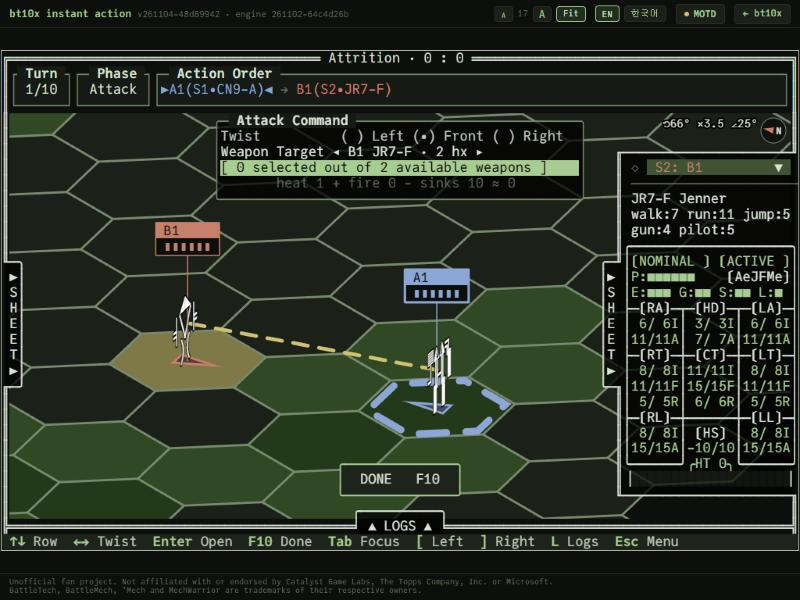](i14_attack.png)

*Figure 23. The Alpha Striker Jenner ran straight in to 2 hexes. Two weapons are available. — [i14_attack.png](i14_attack.png)*

Each row of the **Fire weapons** dialog shows location, TN, hit chance, damage and heat. Weapons that cannot fire are grayed out with a reason. Click the `[ ]` boxes to select weapons; the total fire heat is shown at the bottom.

[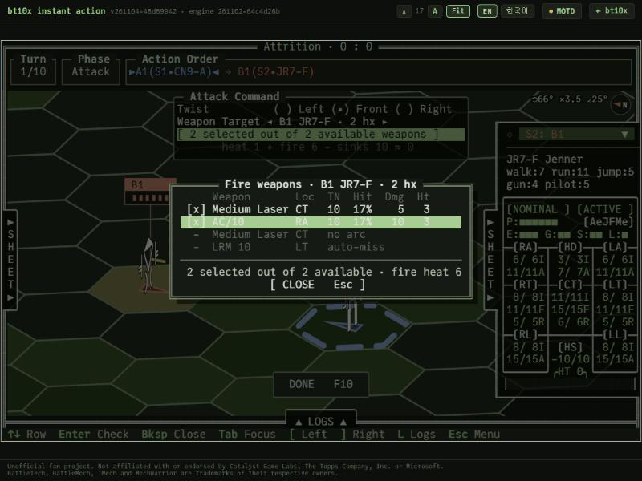](i15_weapons.png)

*Figure 24. Medium Laser and AC/10 selected (TN 10, 17% each; fire heat 6). The rear Medium Laser has "no arc" and the LRM 10 is marked "auto-miss". — [i15_weapons.png](i15_weapons.png)*

Press <kbd>Esc</kbd> to close, then **[DONE F10]** to declare. All declared attacks resolve together.

### Step 10. Logs and record sheets

Click **▲ LOGS** (or press <kbd>L</kbd>) for the turn-by-turn log: initiative, each move, and each shot's TN and roll.

[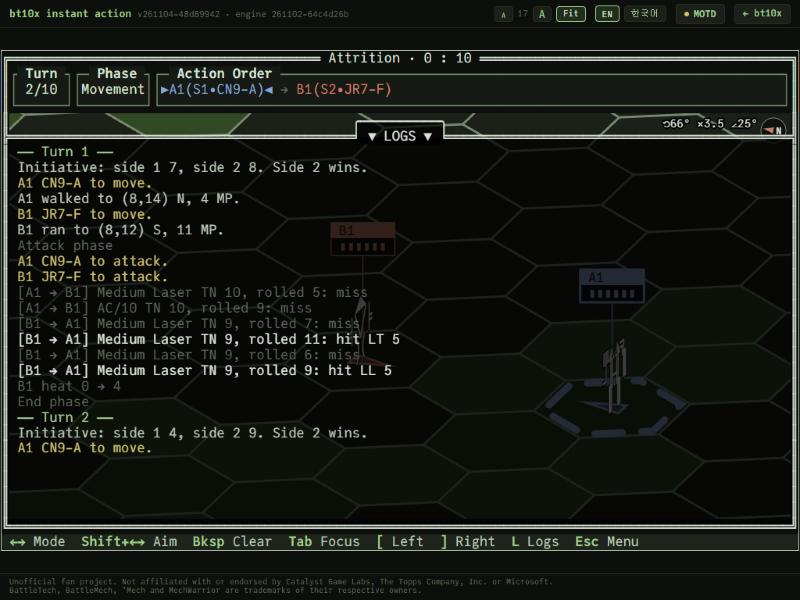](i16_logs.png)

*Figure 25. Turn 1: both of A1's shots missed; two of the Jenner's four Medium Laser shots hit A1 for 5 each (LT and LL). The header now reads `Attrition · 0 : 10`. — [i16_logs.png](i16_logs.png)*

The **SHEET** tabs on either side (<kbd>[</kbd> left, <kbd>]</kbd> right) open full record sheets. Hover a location to see its critical slots in the middle.

[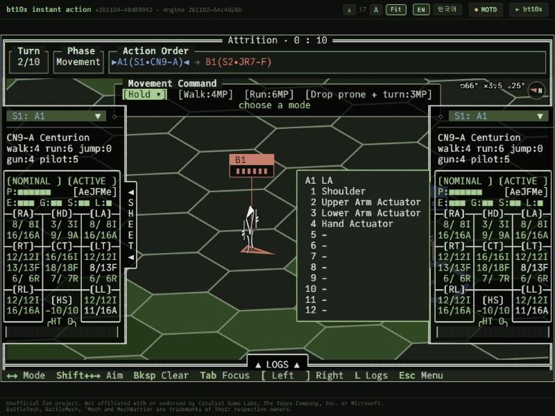](i17_sheet.png)

*Figure 26. Record sheets on both sides and A1's left arm (LA) critical slots. Damage shows as LT 8/13F and LL 11/16A. — [i17_sheet.png](i17_sheet.png)*

### Step 11. Battle menu

Press <kbd>Esc</kbd> during battle for the menu: change persona pace and animations, edit a unit's policies, or **Withdraw to setup** to return to the setup screen.

[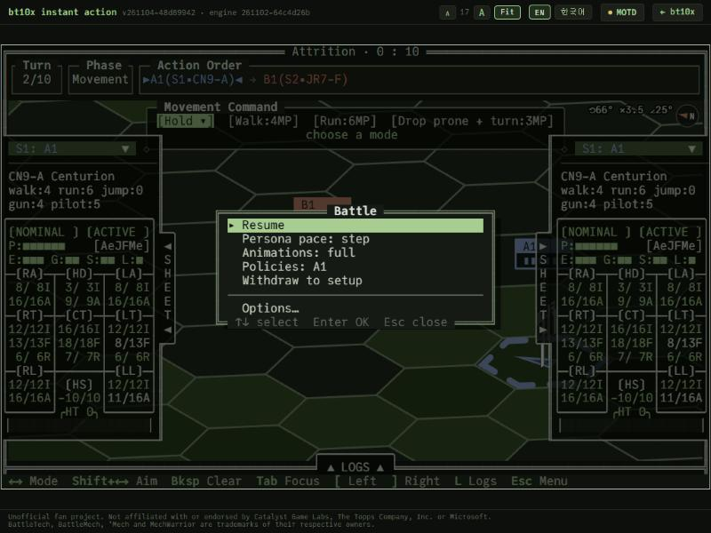](i18_menu.png)

*Figure 27. Battle menu. — [i18_menu.png](i18_menu.png)*

### Instant Action key reference

| Screen | Keys | Action |
|---|---|---|
| Menus and setup | <kbd>↑</kbd> <kbd>↓</kbd>, <kbd>Enter</kbd>, <kbd>[</kbd> <kbd>]</kbd>, <kbd>Esc</kbd>, <kbd>F10</kbd> | Select, confirm/open, switch group, menu, launch |
| Deployment | <kbd>↑</kbd> <kbd>↓</kbd>, <kbd>←</kbd> <kbd>→</kbd>, <kbd>Bksp</kbd>, <kbd>F10</kbd> | Select unit, facing, pick up, done |
| Movement | <kbd>←</kbd> <kbd>→</kbd>, <kbd>Shift</kbd>+<kbd>←</kbd> <kbd>→</kbd>, <kbd>Bksp</kbd>, <kbd>F10</kbd> | Mode, aim (facing), clear, done |
| Attack | <kbd>↑</kbd> <kbd>↓</kbd>, <kbd>←</kbd> <kbd>→</kbd>, <kbd>Enter</kbd>, <kbd>F10</kbd> | Row, twist, open/check, done |
| Anywhere | <kbd>Tab</kbd>, <kbd>[</kbd> <kbd>]</kbd>, <kbd>L</kbd>, <kbd>Esc</kbd> | Focus, left/right sheet, logs, menu |

---

## 6. Glossary

| Term | Meaning |
|---|---|
| MP | Movement Points. Differ for walk, run and jump; spent on terrain and facing changes. |
| TN | Target Number. Roll 2D6 equal to or above it to succeed. |
| TMM | Target Movement Modifier. The more a target moved, the harder it is to hit. |
| Gunnery / Piloting | Pilot skills. Lower is better; Regular is 4/5. |
| BV | Battle Value. A combat-strength score used to balance matches. |
| HD CT LT RT LA RA LL RL | Head; center, left, right torso; left, right arm; left, right leg. |
| F / R / A / I | Front armor / rear armor / armor / internal structure. |
| HS | Heat sinks. How much heat can be shed per turn. |
| Critical hit | A check when internal structure is damaged; can destroy equipment or detonate ammo. |
| S / M / L | Short / medium / long range brackets. Longer range raises the TN. |
| Minimum range | Some weapons, such as LRMs, take a to-hit penalty when the target is too close. |
| Initiative | The side that wins moves last and gains an information advantage. |
| Annihilation / Attrition | Instant Action engagements: wipe out the enemy, or a damage-scoring race within a turn limit. |
| DFA | Death From Above. A physical attack landing a jump on the target. |
| Persona | BT10X's AI pilots. Each scores moves and attacks with its own weights. |

---

## 7. FAQ

**I typed a command in the Terminal and nothing happened.**
Click the input line once to focus it, type, and press <kbd>Enter</kbd>. If the command is not valid in the current phase, check `help`.

**I confirmed a move by mistake.**
In the Terminal, `rollback` undoes the last `done`. It even works after the game ends, returning you to the last combat prompt.

**I want to show my team the exact same battle.**
The same seed, roster and inputs produce the same result. Share `seed <n>` in the Terminal, or the Random Seed value on the Instant Action setup screen.

**My hit chances are terrible.**
Look at the TN breakdown. Long range (+4), a target in woods (+1 to +2) and a target that moved a lot (TMM) stack up fast. Close the distance, or move less to lower your own movement modifier.

**Which 'Mech should I start with?**
For learning the rules, mediums with few weapons such as the Centurion or Hatchetman. Assault 'Mechs carry many weapons and need careful heat management, which is a lot to take in at first.

---

*BattleTech, BattleMech, 'Mech and MechWarrior are trademarks of their respective owners. BT10X is an unofficial fan project. This manual reflects the versions available on 2026-11-05.*
